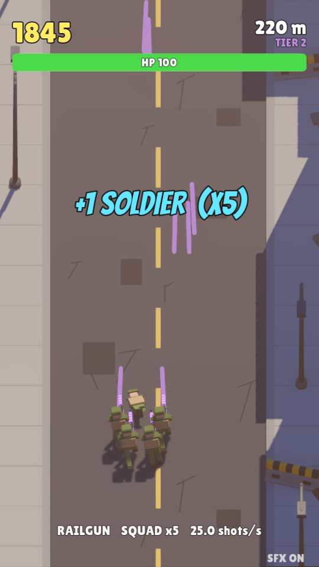
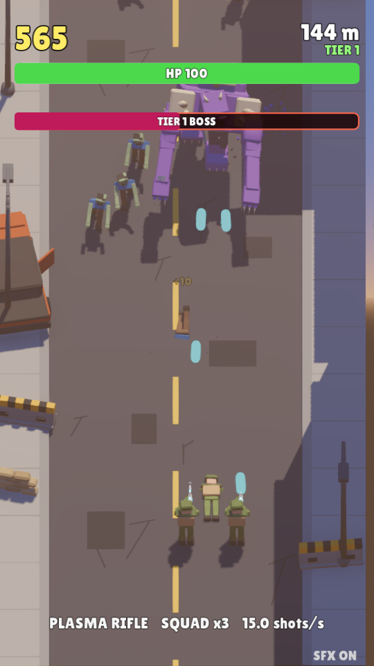
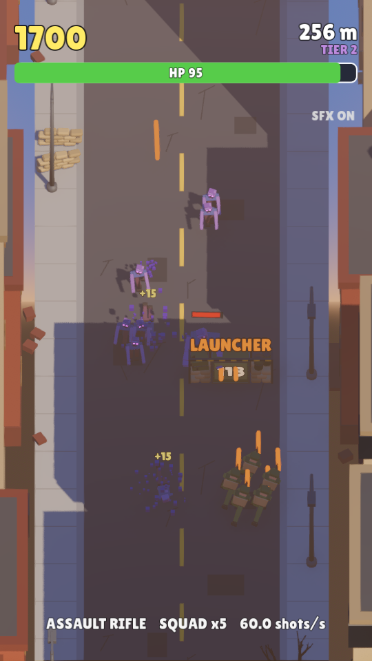

# Lane Rush — zombie road lane shooter

A playable version of the "soldier walks down a two-lane road" mobile-ad shooter, seen from a
high-angle isometric-style camera: zombies pour down **both** lanes, wide upgrade gates block the
**right** lane, and every gate shows the **number of shots** needed to crack it open. You never stop
shooting — the whole game is deciding when to clear zombies and when to invest shots in a gate.
Every upgrade is visible: more soldiers in the squad, a new gun with new ammunition, more bullets in
the air, or a splash-damage launcher. Every few dozen kills a giant boss blocks the road; kill it and
the horde mutates (new colour, much tougher), so upgrades become mandatory.

Built with **Godot 4.7** (GDScript) + **Blender 5.2** (all 3D assets are generated by scripts, no
hand-modelling) + procedurally generated audio (numpy). Portrait, touch-first, also plays with a keyboard.

<p align="center">
  
  
  
</p>

## Play it

```bash
./run.sh                 # run from source (uses the `godot-4` snap)
./export/linux/lanerush.x86_64   # standalone Linux build (if present)
./run.sh --editor        # open in the Godot editor
./run.sh --test 90       # bot plays for 90 s, screenshots land in .screenshots/test/
```

Controls: **drag** (touch / mouse) or **A / D / ← / →** to slide between lanes. Tap / Space to start.
**M** toggles sound.

## Gameplay

| Thing | Behaviour |
|---|---|
| Squad | 1–5 soldiers in formation, running forward, auto-firing; side soldiers converge their fire |
| Zombies (both lanes) | walk toward you, steer into your lane when close; a bite costs 15 HP (brute: 35) |
| Brutes | appear after ~100 m, HP bar over the head, slow but tanky |
| Gates (right lane) | 3.4 m wide barricades: number = shots required; each hit counts down; at 0 it bursts |
| Boss | every 28 (+14 per tier) kills a 5 m super-zombie walks down the road; the run halts until it dies |
| Tiers | after each boss the horde recolours (green → violet → crimson → ash → gold → frost) and gets +75 % HP per tier |
| Score | 10 (+5/tier) per zombie, 60 per brute, 500+ per boss, 25 per gate; best saved to `user://save.cfg` |

Upgrades (all visual):

| Gate | Effect |
|---|---|
| +1 SOLDIER | another soldier joins the formation (max 5), each one fires |
| NEW WEAPON | Rifle → Assault rifle → Plasma rifle → Railgun: new gun model, new ammo look, more damage (railgun pierces) |
| FIRE RATE+ | more bullets per second from every soldier |
| LAUNCHER | 18 s grenade launcher: fire rate ×0.28, damage ×3.2, explodes with 2.9 m splash on impact |
| +40 HP / SHIELD / NUKE | heal, 7 s invulnerability, wipe the screen (and 15 % of a boss) |

Difficulty scales with distance and tier; gate numbers scale with the squad's shots per second so a gate
always costs a meaningful slice of the shots you can land while it is on screen. Boss HP scales with
your current damage output (≈15 s of sustained fire), so a weak squad meets a weak boss but a tier
jump without upgrades becomes lethal.

## Project layout

```
project.godot          Godot project (Forward+ renderer, 720x1280 portrait, touch emulation)
scenes/main.tscn       root scene -> scripts/game.gd builds everything else in code
scripts/
  game.gd              state machine, environment/camera, spawning, scoring, autopilot bot
  player.gd            movement, auto-fire, HP, power-up stats
  weapons.gd           weapon tiers (gun model, ammo look, damage) + launcher definition
  zombie.gd            regular / brute / boss behaviour, tier recolouring
  crate.gd             the upgrade gate (shot counter + reward)
  powerup.gd bullet.gd pickups and projectiles (launcher rounds explode with splash)
  world.gd             road streaming + side props (buildings, lamps, wrecks)
  hud.gd               HP bar, score, popups, menu / game-over overlays
  rig.gd               procedural run/shamble animation for the part-based characters
  fx.gd                particle bursts, floating text, flashes, shock rings
  globals.gd sfx.gd    autoloads: constants, save data, model loader, audio pool
assets/models/*.glb    generated by tools/blender (see tools/blender/ASSET_SPEC.md); gate/weapons/boss in make_upgrades.py
assets/audio/*.wav     generated by tools/audio/gen_sfx.py
assets/fonts/          Bangers, Lilita One, Rubik (SIL OFL, licences alongside)
tools/blender/         Blender python scripts: build_all.sh regenerates every model
tools/audio/           numpy sound + music synthesiser
export_presets.cfg     Linux / Android / Web export presets
```

If Godot refuses to start with `Couldn't create Vulkan device (VkResult error -2 / -3)`, the GPU has no free
VRAM (e.g. local LLM servers are using it). `run.sh` then automatically downloads a non-snap Godot into
`.godot-bin/` and retries on the CPU Vulkan driver (lavapipe, slow but it runs). Free VRAM for full speed.

## Regenerating assets

```bash
PREVIEW_DIR=/tmp/previews bash tools/blender/build_all.sh   # all .glb files + preview renders
python3 tools/audio/gen_sfx.py                               # all .wav files
./run.sh --import                                            # re-import into Godot
```

The camera is set up in `scripts/game.gd` (`CAM_ORTHO`, `CAM_PITCH_DEG`, `CAM_YAW_DEG`, `CAM_SIZE`); flip
`CAM_ORTHO` to false for the original behind-the-shoulder perspective camera.

Characters are exported as a hierarchy of separately pivoted parts (Hips/Torso/Head/Arms/Legs/Gun/Muzzle),
and `scripts/rig.gd` animates them procedurally, so no rigging or keyframes are needed.

## Exporting

Export templates for Godot 4.7.2 (mono) are installed under
`~/snap/godot-4/current/.local/share/godot/export_templates/`.

```bash
godot-4 --headless --path . --export-release Linux export/linux/lanerush.x86_64
godot-4 --headless --path . --export-release Web   export/web/index.html      # serve the folder over http
```

Android needs the Android SDK + a debug keystore configured in Editor Settings
(Editor → Editor Settings → Export → Android), then:
`godot-4 --headless --path . --export-debug Android export/android/lanerush.apk`.

## Why Godot and not Unreal / Unity

Unreal Engine 5 cannot be installed unattended on Linux: Epic's binaries and the `EpicGames/UnrealEngine`
source repo both require an Epic account linked to GitHub. Unity's editor can be downloaded, but it
cannot be licensed headlessly without a Unity ID login. Godot 4.7 was already installed, runs headless,
and exports to Android/iOS/Web, so the game was built there. To unlock UE later: link your GitHub
account at https://www.unrealengine.com/en-US/ue-on-github, then `git clone` the engine and run
`Setup.sh && GenerateProjectFiles.sh && make`.

## License

Everything in this repository (code, generator scripts, and the generated models and audio) is released
under the [MIT License](LICENSE). The bundled fonts (Bangers, Lilita One, Rubik) are under the
SIL Open Font License; their licence texts are in `assets/fonts/`.
